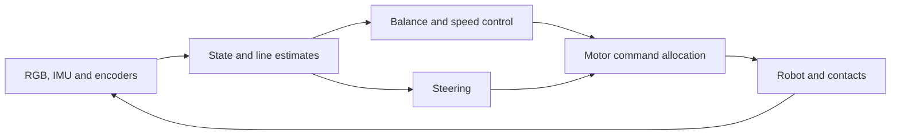

# Control and learning: a starting point

This guide introduces ideas that can help you design experiments for
[Line Following](README.md). It assumes basic linear algebra, derivatives and
familiarity with PyTorch. The [mechanics guide](dynamics.md) defines the actual
robot and simulator. The reduced models below explain control principles; their
approximations need to be checked against that simulator.

A useful sequence of experiments is supported driving, balancing near the upright
position, slow line following, and then speed selection and adaptation. These are
possible components of a solution, not required implementation stages. You may
learn a complete policy instead. In either case, distinguish the true physical
state, the measurements available to the controller, and its internal estimates.

## Why moving the wheels can prevent a fall

Consider a point mass on an upright rigid rod of length $\ell$, attached to a
horizontally moving support. Let $\theta$ be the forward lean angle and $p$ the
support position. Near the upright position, its equation is approximately

$$
\ddot\theta = \frac{g}{\ell}\theta-\frac{1}{\ell}\ddot p.
$$

With a stationary support, a forward lean produces further forward angular
acceleration: the equilibrium is unstable. Accelerating the support towards the
fall can counteract that acceleration. For example, an ideal support-acceleration
command $\ddot p=k_p\theta+k_d\dot\theta$ gives

$$
\ddot\theta+\frac{k_d}{\ell}\dot\theta
+\frac{k_p-g}{\ell}\theta=0.
$$

This simplified system is stable when $k_p>g$ and $k_d>0$. The first term in the
command corrects the lean; the second damps angular motion. These gains command
an ideal acceleration, whereas the lab robot accepts bounded motor inputs. Wheel
inertia, motor reaction torque, slip and contact loads change the relationship
between an input and acceleration. The calculation explains the mechanism without
providing gains for the simulated robot.

Balancing angle alone also permits the robot to drift. A practical controller
usually relates balance to longitudinal velocity or position error. One possible
architecture has a slower velocity loop that requests a small lean, a faster
balance loop that controls the common motor input, and a steering loop that
controls the difference between the two motors. Their requests share the same
actuation and traction limits.

The rear sphere changes the mechanics. When it supports the body, its contact
constrains lean and adds resistance. A controller derived near upright balance
need not work while resting on the sphere or during lift-off. Examine these regimes
separately before relying on a single local model.

## A minimal linear control model

### State, input and linearisation

Write nonlinear dynamics as $\dot x=f(x,u)$. Around an equilibrium
$f(x_*,u_*)=0$, define deviations $\delta x=x-x_*$ and $\delta u=u-u_*$. A first-order
approximation is

$$
\delta\dot x=A\delta x+B\delta u,\qquad
A=\left.\frac{\partial f}{\partial x}\right|_*,\quad
B=\left.\frac{\partial f}{\partial u}\right|_*.
$$

A reduced balancing state might contain displacement, velocity, pitch and pitch
rate. Such a model describes a neighbourhood of an operating condition. It does
not include every contact or friction transition in the full simulator. You can
estimate a local response from small input perturbations or derive a reduced
mechanical model. Compare predicted and measured responses before designing
feedback from it.

Under state feedback $\delta u=-K\delta x$, the linearised dynamics become
$\delta\dot x=(A-BK)\delta x$. In continuous time, asymptotic stability requires
all eigenvalues of $A-BK$ to have negative real parts. Their imaginary parts and
magnitudes affect oscillation and decay rates. Large gains can demand more torque
than the motors supply or amplify measurement noise.

The controller acts every $\Delta t=0.02$ s. For a linear model with input held
constant between calls, the corresponding sampled model is

$$
\delta x_{k+1}=A_d\delta x_k+B_d\delta u_k,\qquad
A_d=e^{A\Delta t},\quad B_d=\int_0^{\Delta t}e^{A\tau}B\,d\tau.
$$

Its closed-loop eigenvalues must lie inside the unit circle. A controller designed
as though measurements and corrections were continuous can behave differently at
this sampling rate. The simulator's 1 ms integration step does not provide the
controller with measurements every millisecond.

### PD, PID and LQR

For a scalar error $e$, a PID law combines proportional correction, accumulated
error and its rate of change:

$$
u=k_p e+k_i\int e\,dt+k_d\dot e.
$$

A PD law omits the integral. Integral action can compensate a persistent bias, but
an integral that keeps growing while the motor is saturated causes *windup*.
Limit or suspend accumulation when appropriate. Differentiating noisy measurements
also amplifies noise; measured angular rate or a filtered difference is often more
useful. Define the error sign and check the response to a small perturbation before
increasing gains.

Linear quadratic regulation (LQR) chooses a feedback matrix for a linear model
using a quadratic cost, for example in discrete time:

$$
J=\sum_{k=0}^{\infty}
\left(\delta x_k^TQ\delta x_k+\delta u_k^TR\delta u_k\right),
\qquad Q\succeq0,\quad R\succ0.
$$

Under the usual stabilisability and detectability conditions, a Riccati equation
gives a stabilising feedback law. The weights describe the relative cost of state
errors and effort; their units and scaling matter. This is a local design tool.
It does not enforce the robot's input bounds or guarantee stability after loss of
traction. Russ Tedrake's [LQR notes](https://underactuated.mit.edu/lqr.html) explain
the derivation and local control of nonlinear systems.

## Estimating the quantities a controller needs

The controller receives RGB, body angular velocity, specific acceleration,
body-relative wheel angles and time. It receives neither pitch nor true ground
velocity. A controller written in terms of those quantities therefore needs an
estimator.

Near planar motion, the y component of `gyro` approximates pitch rate. Integrating
it estimates pitch change, but noise accumulates and the initial angle still
matters. With negligible translational acceleration and roll, an accelerometer
estimate under this lab's coordinate convention is

$$
\theta_{acc}=\operatorname{atan2}(-a_x,a_z).
$$

During acceleration, the same measurement contains both gravity's contribution
and motion. Treating it as a direct tilt measurement can produce an incorrect
correction precisely when the robot is accelerating to balance.

A complementary filter illustrates how two imperfect signals can be combined:

$$
\hat\theta_k=\beta\left(\hat\theta_{k-1}+\Delta t\,\omega_{y,k}\right)
+(1-\beta)\theta_{acc,k},\qquad 0<\beta<1.
$$

This is a planar approximation. Choose the time scale deliberately, initialise it
on episode reset, and inspect its error during acceleration and contact changes.
For larger rotations, body gyro components are not individually equal to Euler
angle rates; use the rotation kinematics from the mechanics guide.

Encoder differences estimate relative wheel rotation. Converting them to ground
velocity assumes rolling and must account for body rotation as well as wheel
rotation. Slip violates that assumption. Gyro integration can provide short-term
heading changes, but there is no absolute compass measurement. A model-based
observer predicts motion and corrects it from sensor residuals; an extended Kalman
filter is one possible extension when the nonlinear model and noise assumptions
are adequate. The [output-feedback notes](https://underactuated.mit.edu/output_feedback.html)
discuss state estimation together with control.

During training you can compare estimates with the true state in `info`. Keep that
comparison in experiment code: the evaluated controller must update its estimates
using only its observations and actions.

## Following a line with conventional control

### Extracting an error from the optical row

For nominal sensor width $W=0.094$ m, the transverse centre of sector $i$ is

$$
y_i=W\left(\frac{i+1/2}{16}-\frac12\right),\qquad i=0,\ldots,15.
$$

Positive $y$ is to the robot's left. Let $w_i\geq0$ measure evidence of line paint
in that sector, derived from brightness or colour. When enough paint is visible,
a weighted centroid gives a simple lateral observation:

$$
e=\frac{\sum_iw_i y_i}{\sum_iw_i}.
$$

Retain a separate visibility/confidence measure. An empty row must not be
interpreted as a perfectly centred line. Blue and red markers are also line
paint; a detector designed only for neutral dark pixels may lose them. Sector
averaging, noise and tilt affect the measurements, so sub-sector offsets are
estimates rather than exact geometric coordinates.

A single transverse observation does not determine line heading. Changes in
lateral error, together with angular velocity and estimated forward motion,
provide evidence over time. The same error can evolve differently during forward
and reverse travel. This is a reason to retain a short measurement history or an
explicit heading estimate.

### Steering, speed and recovery

For common input $u$ and differential input $d$, commands can be expressed as

$$
a_L=u-d,\qquad a_R=u+d.
$$

In nominal forward rolling, positive $d$ favours a left turn. A basic line follower
can use lateral error and its change to request steering, with gyro feedback to
damp yaw. Check the signs during reverse travel. Clipping the two final commands
independently can alter both the requested common and differential components;
available motor effort has to serve balance, travel and steering together.

At higher speed, the robot covers more distance before its next observation and
has less time to correct an error. Reducing speed when line confidence decreases,
steering demand rises or recent errors grow is one possible conventional strategy.
Since the sensor does not look ahead, an unseen sharp turn can still require a
stop and recovery.

When the line disappears, its last observed side and recent motion can guide a
short search or a return to an earlier location. Remember that finding paint again
does not prove that the missed route interval was covered. The judge does not
report that event to the controller. At close branches, a centroid of two lines
can fall on unpainted ground between them; distinct candidate lines and temporal
continuity become useful. At crossings, the intended continuation is smooth.
Endpoint colour detection also needs memory: entering red paint is earlier than
covering its final point, and it does not prove that the outward leg was accepted.

### The reference controller

The supplied baseline implements conventional supported driving. Its optical
detector selects a connected dark stripe near the previous observation before
computing a centroid. Brightness is normalised by the recognised paint colour,
so changing between black and endpoint paint does not change the intended
geometry. This avoids averaging separate branches into their white gap; it does not resolve every ambiguous crossing or merged stripe.

The direction estimate uses two observed line points. Wheel rotation and the gyro
provide approximate planar odometry $(\hat x,\hat y,\hat\psi)$ in a local frame
whose origin is the start pose. An optical intersection $(0,e)$ becomes

$$
\hat p=(\hat x,\hat y)+e(-\sin\hat\psi,\cos\hat\psi).
$$

The vector between an earlier point and the current point estimates the line
tangent. Near the centre of the sensor, the controller waits for 16 mm separation
and replaces the earlier point after 32 mm. Beyond 6 mm lateral offset, these
distances decrease to 4 and 8 mm to respond to tighter bends. Separating measurements
in space reduces optical quantisation noise; too long a separation delays the
estimate on a tight bend. The tangent estimate is smoothed and its rate is
limited to 3 rad/s, reducing abrupt turn demands from optical quantisation.
The fit uses net displacement between observed points, allowing 0.7 mm backward
uncertainty. Earlier observations remain available during slow pivots, when the
instantaneous intersection velocity may be nearly zero. Retreat observations never
update the tangent. Fresh forward measurements are required after returning to the
saved point.
On the return leg, the point difference changes sign. Its oriented angle is
unwrapped modulo $2\pi$: choosing an unoriented tangent modulo $\pi$ can select
the wrong continuation of a tight bend.
These points describe the line already observed; extrapolating their tangent is
a local prediction, not a forward sensor or a map of the unobserved route.

A related differential estimate follows from planar rolling. If $v$ is body
forward speed, $\omega$ yaw rate, and $\alpha$ the line heading relative to the
body, the world velocity of the intersection $(0,e)$, expressed in body
coordinates, is $(v-\omega e,\dot e)$. Therefore

$$
\dot e=(v-\omega e)\tan\alpha.
$$

The rotational term matters during slow turns with a large offset. Directly
estimating this derivative from consecutive optical rows amplifies noise and
becomes ill-conditioned when $v-\omega e$ is small; spatially separated points
avoid that division. Neither method removes errors from slip, body tilt or
ambiguous paint. The baseline uses the public wheel radius
and planar gyro integration, correcting the body-Z rate for the approximate
supported pitch of $-0.25$ rad; it is not a full state observer.

With travel direction $d\in\{-1,1\}$, the requested yaw rate is

$$
\omega_* = k_\alpha\left[\alpha+\operatorname{clip}(\arctan(de/\ell),-0.5,0.5)\right],
$$

where $\ell=0.08$ m sets a lateral convergence distance. This parameter is a
control scale, not the range of a forward-looking sensor. Proportional heading
feedback requests a yaw rate; measured gyro rate damps the motor difference.
On a straight line, with constant forward speed and instantaneous, noiseless
heading feedback, linearisation gives
$\ddot e+k_\alpha\dot e+(vk_\alpha/\ell)e=0$. Its damping ratio is
$\zeta=\tfrac12\sqrt{k_\alpha\ell/v}$, about 1.29 at the configured cruise speed.
This motivates a smooth approach to the line; it is not a stability proof for
the full robot with delayed direction estimates, friction and motor saturation.
There is no heading integral, so an outdated tangent does not accumulate a turn
demand. PI speed control drives the common motor input. Along-line speed $u$
decreases with offset, heading error, yaw rate and stripe width. The body-speed
request coordinates translation with turning:

$$
v_* = u\cos\alpha + \omega e.
$$

In the reduced planar model, $v-\omega e$ is the forward component of the line
intersection's velocity. This correction avoids sweeping the intersection out
of the sensor during a slow turn. Requested speed and yaw rate have bounded
rates of change. Both red and blue endpoints reduce speed; after reaching the
physical end the controller changes the sign of travel without rotating the body.
The initial blue marker is not the outward destination. Direction estimation and
turn-dependent slowing remain active on coloured paint; recognising an endpoint
must not suppress the remaining line geometry.

Recovery has four states: follow, retreat, settle and approach. The controller
stores recent points **on the line** and their fitted tangents, about 20 mm apart.
On line loss it freezes the older point and tangent. It reverses along that virtual
line until it is at least 35 mm behind the point and within 3 mm laterally.
It then stops and waits for both heading and yaw rate to settle before approaching
again. Seeing paint during the retreat is not sufficient to resume normal driving.
During the approach it gathers fresh forward observations and keeps speed low;
the probing distance includes the retreat and extends 40 mm beyond the estimated
loss location. A small offset, heading error and yaw rate allow normal tracking.
Passing the saved point is latched: a hairpin may bring the robot behind that
point's incoming tangent plane again without restarting virtual-line alignment.

The virtual line may lie outside the sensor. During recovery, turn about the axle
rather than applying the visible-line compensation $\omega e$ to an unseen point.
The condition permitting translation must use the same heading target as steering,
including lateral correction; otherwise a robot can satisfy steering while its
independent movement condition keeps it stopped indefinitely.
The controller uses only RGB,
encoders and gyro; it cannot certify that this recovered position lies before
the judge's frontier. Odometry drift and a wrong branch can still defeat this
short recovery procedure.

At an intersection, the centroid of merged branches is not a point on the branch
being followed. At the first unexpectedly wide observation, the baseline saves
the incoming line point and tangent. It continues ordinary tracking until paint
extends to both sides of this saved line. Confirmation then restores that earlier
estimate for crossing control. Both detection and control must use the estimate
from before the wide paint: an updated centroid could otherwise turn an ordinary
corner into an apparent crossing. Using odometry and gyro feedback,
it follows this virtual line at 0.04 m/s and selects the emerging stripe nearest
the predicted sensor intersection. A narrow compatible stripe must persist over
12 mm of travel before normal fitting resumes. The probe is limited to 140 mm;
loss of paint or exhausting that distance invokes ordinary retreat. One-sided
widening alone does not trigger this mode, because a sharp corner or the
connection between nearby parallel branches can produce it.
Coloured paint, including a faint marker at the edge of the row, retains normal
tracking and endpoint handling rather than triggering a straight crossing probe.
These thresholds are heuristics for the published geometry, not a proof of
correct branch selection under all slip, curvature and noise conditions.

`debug()` extends the base controller's sensor snapshot with offset, estimated heading and speed, recovery state, travel
direction, crossing-probe state, measured/requested yaw rate and motor inputs. Compare these estimates with the simulator
in training and inspect unsuccessful runs. The baseline does not balance upright,
learn dynamics, build a route map or optimise the return journey. Its measured
reference results and remaining failures are given in the
[lab statement](README.md#reference-measurements-and-experimental-comparison).

## Learning a controller from interaction

### Policy, reward and memory

In reinforcement learning, an agent chooses actions and learns from the resulting
rewards. Here a policy receives observation $o_t$ and may maintain memory $m_t$:

$$
m_{t+1}=F_\vartheta(m_t,o_t),\qquad
a_t\sim\pi_\vartheta(\,\cdot\mid o_t,m_t).
$$

Training seeks a high expected return, commonly
$\mathbb E[\sum_{t=0}^{T-1}\gamma^t r_t]$, with discount $0<\gamma\leq1$ and $T$
control transitions in the episode. Memory is useful because the current sensor
row does not reveal the full state, route direction or robot parameters. It can
be an explicit estimator, a short observation history or a recurrent network.
Sutton and Barto's [Reinforcement Learning: An Introduction](https://mitpress.mit.edu/9780262039246/reinforcement-learning/)
provides the background on returns, value functions and policy learning.

Training code can read `info["progress"]` in metres and its per-step increment.
These values can supervise a progress predictor, shape a reward or train a critic.
Keep them outside the policy observation: validation and assessment call `act()`
with only the published sensor dictionary and reset mask. A recurrent policy must
infer successful recovery from those sensors.

The default progress reward helps discover motion along the route, but by itself
it does not reproduce the time-based competition score. Partial progress can give
positive training reward even when the episode ultimately fails. Time cost,
success/failure outcomes and control regularisation are possible additions; check
whether they improve the actual average score. A poorly chosen penalty can make
remaining still preferable to attempting the course. A reward for repeated visible
paint can encourage behaviour that earns no route progress.

### Approaches to investigate

Learning can begin with a small number of controller or estimator parameters.
Optimise them on varied training episodes and compare with their initial settings.
Another option is to imitate a conventional controller, then improve the policy
through interaction. A learned residual can adjust the output of an existing
controller; this reduces the initial search space but does not automatically
preserve its stability.

For direct continuous-action learning, actor–critic methods combine an action
policy with an estimate of future return. The critic helps evaluate actions;
a fixed policy can act using the actor and its state alone. Two examples are
[Proximal Policy Optimization](https://arxiv.org/abs/1707.06347), which discourages
large policy changes through a clipped optimisation objective, and
[Soft Actor-Critic](https://arxiv.org/abs/1801.01290), which reuses stored transitions
and includes an entropy objective. Neither method is prescribed. Understanding
observation history, rewards and episode boundaries matters before adapting an
algorithm to this task.

The simulator can supply training targets or a critic with information unavailable
at deployment. The final actor, including any online update, must still operate
from the documented observation stream. Learning a dynamics model for short-horizon
planning is another possibility; model errors near slip and changing contacts
should be measured explicitly.

### Organising robot experiments

Use the batched environment to collect experience from several episodes. The Numba
engine reuses compilation across batch lengths; reset completed rows independently and
clear only their controller memories. Preserve the final observation before
resetting. In this lab, the `30 * T_100` timeout is a scored failure: although the API
labels it `truncated`, it is not merely an arbitrary training rollout cutoff.
Decide value targets accordingly. A rollout buffer boundary while an episode is
still running is a different event.

Vary geometry and explicitly generated robot cases during training, retaining simpler
cases as difficulty increases. Repeat fixed cases for reproducible comparisons and
prepare additional cases with `sample_case` to estimate sensitivity to dynamics. Keep model selection separate from the
experiments used to report generalisation. Record training cost and failed episodes,
and compare against the conventional controller under the same conditions.

Finally, the autodiff mechanics example does not make
`Environment.step` differentiable through an entire trajectory. The environment
detaches actions and uses NumPy for geometry and judging; contacts and termination
also introduce nonsmooth events. Policy-gradient methods learn from collected
transitions and need no derivative through that simulator. Gradients computed
inside `act` for a learned model or online adaptation are a separate capability.
